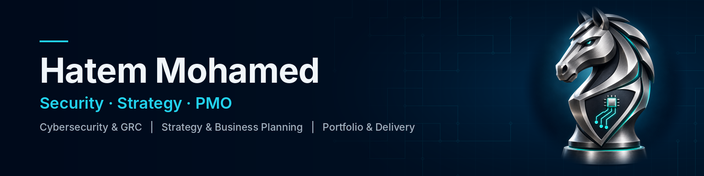

  

I head Strategy & Business Planning, including PMO and Delivery, at a giga-project in Saudi Arabia. My background spans cybersecurity, governance, risk and compliance, PMO governance, digital transformation and infrastructure delivery.

## What I work on

**Strategy & business planning**
Strategic and business planning, capability mapping, portfolio direction, and vendor and contract management.

**PMO & delivery**
Portfolio, program and project delivery at scale, from intake and prioritization to execution, reporting and governance.

**Cybersecurity & GRC**
Governance, risk and compliance, data protection and classification, third-party risk, and secure software delivery.

**Technology & infrastructure**
Enterprise architecture, enterprise platforms, network and data center infrastructure, and digital transformation.

## Technology stack

**Security & GRC:**         

**Security operations & architecture:**      

**Strategy & portfolio:**          

**Architecture & enterprise platforms:**        

**Infrastructure & networking:**       

**Engineering & automation:**      

## Certifications & education

| Area | Credentials |
| --- | --- |
| Project and program management | PgMP, PfMP, PMP, PMI-ACP, PRINCE2 Practitioner, PMO-CP |
| Security and networking | CISSP, CEH, CC (ISC2), CCNA |
| Education | MSc Cybersecurity Operations and Leadership, University of San Diego |
| | BSc Computer and Control Systems Engineering |

## Featured

**[claude-model-router](https://github.com/knightsfork/claude-model-router)**: an open-source agent skill that routes AI subagent work to the right model tier to cut cost, with an approval gate on the top tier.

## Connect

[LinkedIn](https://www.linkedin.com/in/hatemeng)
